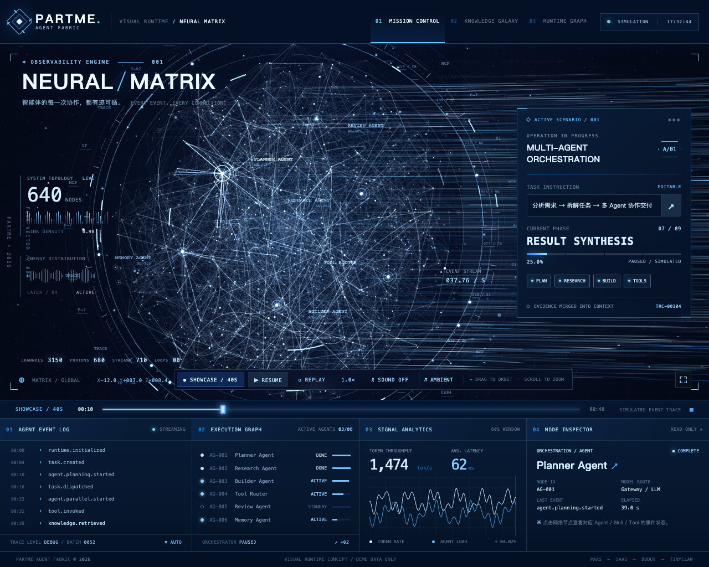

# Partme Neural Matrix V3

Enterprise blue-white Agent Fabric visualization demo.



*Actual browser capture of the interactive demo. Agent and runtime telemetry are simulated.*

## Contents
- src/: maintainable HTML, CSS, JavaScript, and audio controller source.
- scripts/: standalone build and original audio-generation scripts.
- tests_v3.py, verification/: browser test source and captured validation reports.
- media/partme-neural-matrix-v3-bluewhite-40s.mp4: 40-second H.264/AAC showcase video.
- partme-neural-matrix-v3.html: standalone, self-contained browser build when generated with scripts/build_standalone.py.

## Run
From the repository root, start the development server (Python 3 required):

```bash
python3 -m http.server 8765 --bind 127.0.0.1 --directory src
```

Open [http://127.0.0.1:8765/](http://127.0.0.1:8765/). Stop the server with `Ctrl+C`.

Both soundtracks are included under `src/assets/`. Click **SOUND OFF** in the
page to enable playback, then use **AMBIENT / PULSE** to switch tracks.
The visual demo also works without audio files.

To regenerate the soundtracks, build the standalone HTML, and run browser verification:

```bash
python3 -m venv .venv
.venv/bin/python -m pip install -r requirements-dev.txt
# FFmpeg must be on PATH.
.venv/bin/python scripts/generate_audio.py
.venv/bin/python scripts/build_standalone.py
.venv/bin/python tests_v3.py
```

The browser test uses a detected Chromium executable or macOS Google Chrome.
Set `CHROMIUM_EXECUTABLE` to use another installed Chromium browser. If neither
is available, install Playwright's browser with `.venv/bin/python -m playwright install chromium`.
The generated `partme-neural-matrix-v3.html` includes both soundtracks and can be opened offline.
Test reports and screenshots are written to `verification/`.

The media/.incoming/ transfer staging area is intentionally excluded from Git.

## Notes
The visual runtime currently uses simulated Agent/Runtime events. It is a presentation demo, not connected to live Agent Fabric telemetry. Browser audio playback may require a user gesture due to autoplay policy.
